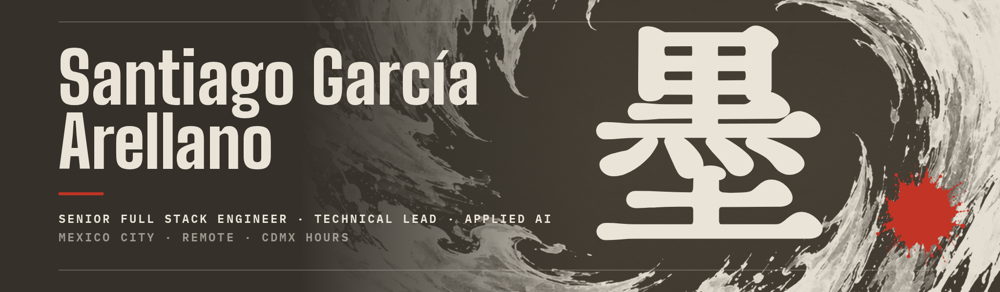

  

# Santiago García Arellano

Mexico City · Remote, CDMX hours · [Official website](https://santiagos.mx/en/)

I’m Santiago García, a Senior Full Stack Engineer and Technical Lead focused on frontend development with TypeScript. I build production software across web, mobile, and applied AI.

**Stack:** TypeScript · Svelte · React / React Native · Astro · Next.js · Node.js · Tailwind CSS · GSAP · PostgreSQL · Firebase · applied AI (RAG, LLMs)

## Selected experience

- **Zorya / Everlay Group · Full Stack Developer:** Built browser and mobile calling with WhatsApp Cloud API, WebRTC, and SignalR. Individual and call center routing ran below 200 ms on Azure. Published a component library adopted by four teams.
- **Sekura · Tech Lead Mobile:** Led four developers from kickoff to production on an Android and iOS claims app. It shipped in three months and reached 88% adoption.
- **Earlier work:** Built production RAG support agents for multiple clients starting in March 2022.

## Projects

- **[Metro GOYN](https://somos.goynmexico.org):** Sole architect and UX/UI developer of an interactive 2.5D system that organizes 19 responses from GOYN CDMX’s 2026 plenary into four metro lines. Co-designed the visual system and signage with Ana Victoria Ávila.
- **[DeUna](https://deuna.cattion.com):** Built with Tania Belen Gayosso Dominguez for Cursor Hackatón México 2026. The live app accepts real CoDi payments from a phone. [Source code](https://github.com/Santiago-mnd/cursor-hackathon-2026).
- **[herdr-usage](https://github.com/Santiago-mnd/herdr-usage):** Built an early-stage, open-source Rust plugin that asks coding agents for a handoff before a usage window ends, then resumes their terminal panes when it resets.

## Community

I’ve volunteered with GOYN CDMX’s Grupo Asesor de Jóvenes (GAJ) since December 2025. I’m also part of Cattion, a three-person collective spanning technology, design, and the humanities. See [Cattion’s site](https://cattion.com) for the games and workshops we’ve brought to Chalco, UNAM’s FES Aragón, and Morelia.

## Contact

[Email](mailto:santiago@santiagos.mx) · [LinkedIn](https://www.linkedin.com/in/santiago-garcia-arellano)

  
<strong>There is a small surprise somewhere here</strong>

   
  

